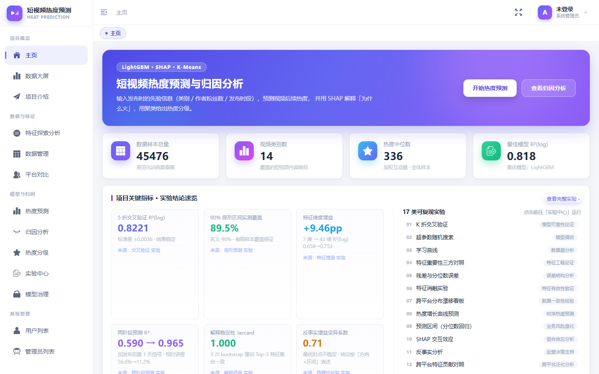
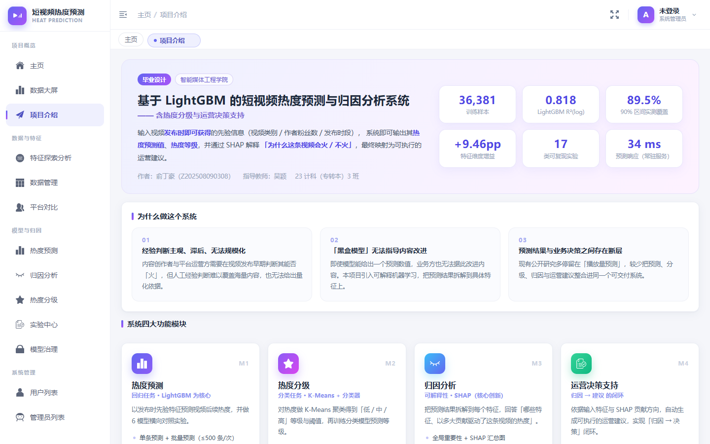
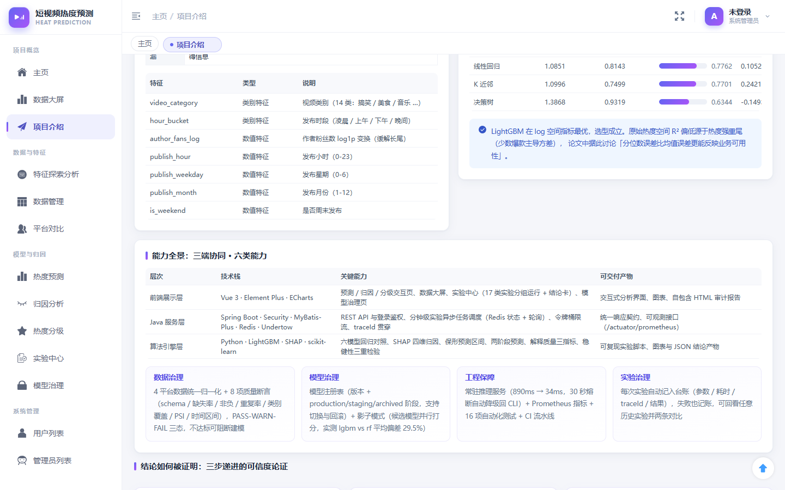
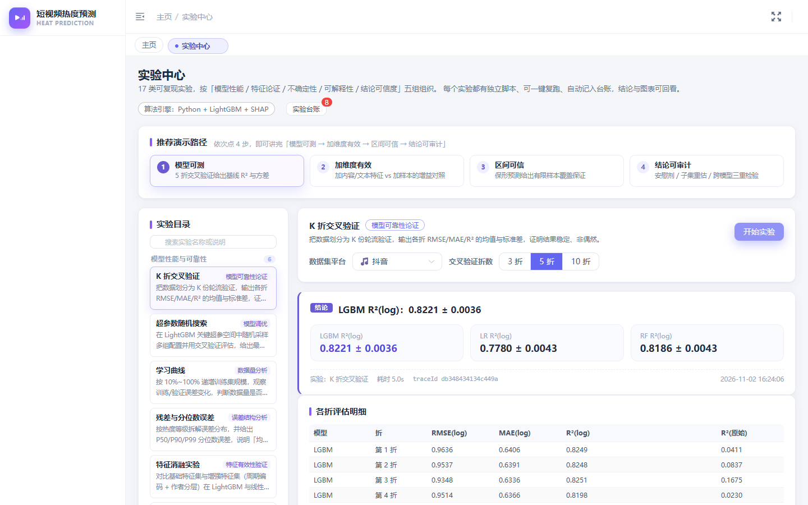
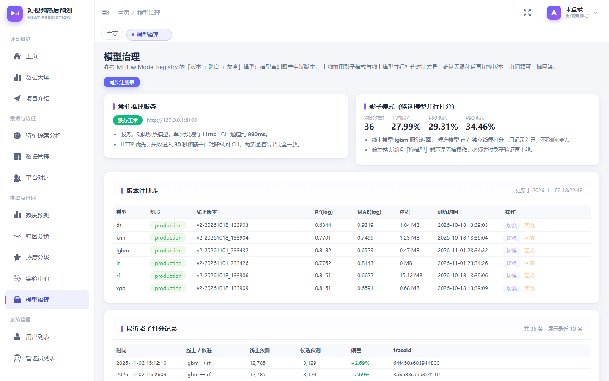
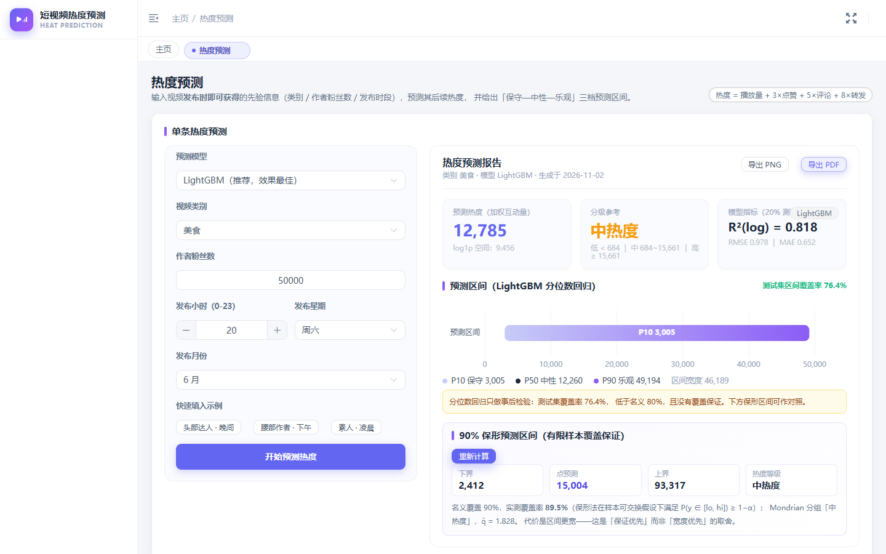
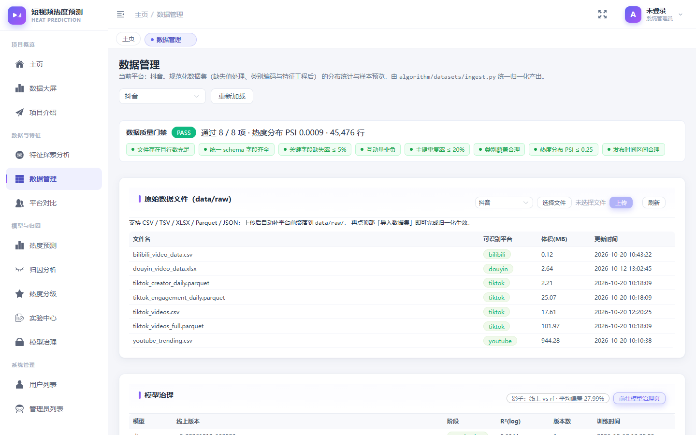
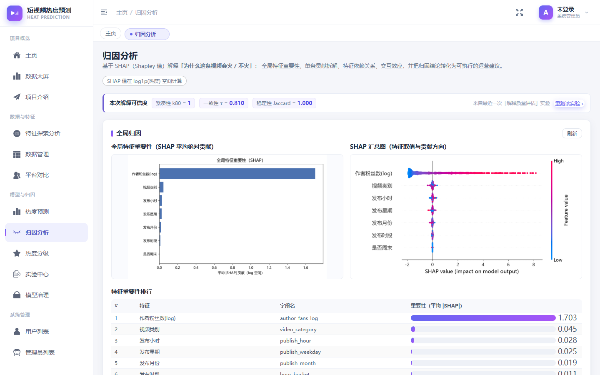
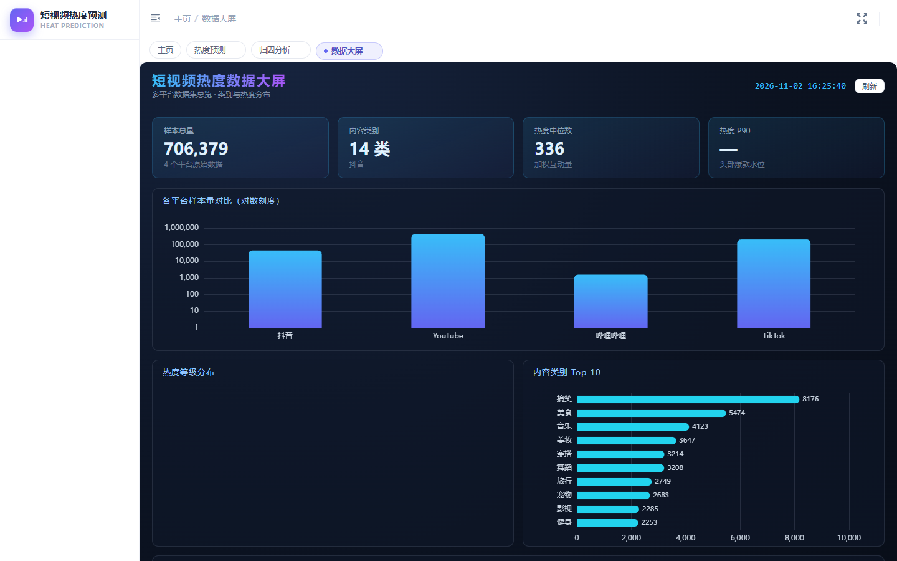

# 短视频热度预测与归因分析系统

基于 **LightGBM + SHAP** 的短视频热度预测、分级与可解释归因 Web 系统（毕业设计）。

> 技术方案文档：[技术方案.md](./技术方案.md)

---

## 界面预览

| 主页 · 实验结论速览 | 项目介绍 · 能力全景 |
|---|---|
|  |  |

| 项目介绍 · 结论如何被证明 | 实验中心 · 17 类可复现实验 |
|---|---|
|  |  |

| 模型治理 · 版本 / 影子 / 引擎状态 | 热度预测 · 分位数区间 vs 保形区间 |
|---|---|
|  |  |

| 数据管理 · 8 项质量门禁 | 归因分析 · 解释可信度徽章 |
|---|---|
|  |  |

| 数据大屏 |  |
|---|---|
|  |  |

> 界面上的每个数字都来自可复现的实验脚本，可在「实验中心」一键重跑；
> 页面右上角的 `?demo=1` 进入答辩演示模式（折叠侧栏、隐藏无关元素）。

---

## 功能总览

| 模块 | 说明 |
|---|---|
| 🎯 热度预测 | LightGBM / XGBoost / RF / LR / KNN / DT 六模型回归对比，单条 + 批量预测 |
| 📊 热度分级 | K-Means 聚类自动定档 + 分类模型预测热度等级（低/中/高） |
| 🔍 归因分析 | SHAP 全局重要性 / 单样本瀑布图 / 部分依赖图 / 交互效应 / 反事实建议 |
| 📈 实验中心 | 17 类实验按「模型性能 / 特征论证 / 不确定性 / 可解释性 / 结论可信度」五组组织，**推荐演示路径 4 步**、结论卡（一句话结论 + 指标 + 脚注 traceId）、台账抽屉支持任意两条实验对比 |
| 📈 模型评估 | 交叉验证 / 超参数搜索 / 学习曲线 / 特征消融 / 残差分析 / 分位数回归 / **保形预测区间（有限样本覆盖保证 + Mondrian 条件覆盖）**，**异步任务 + 实时进度** |
| 🌐 跨平台分析 | 4 平台（抖音 / YouTube / TikTok / B 站）SHAP 贡献对照、分布漂移 PSI/KS 检验 |
| ⏱️ 增长预测 | TikTok 真实每日累计快照 → 发布后 1/3/7 天热度预测 |
| 🗂️ 数据管理 | 数据集注册表、类别分布、时间跨度总览，**原始数据文件上传（自动补平台前缀）与文件清单** |
| 🧾 实验台账 | 每次实验自动记账（参数 / 耗时 / traceId / 结果），前端可回看任意历史实验结果 |
| 🧠 解释质量 | 紧凑性（解释 80% 贡献所需特征数）/ 一致性（三种重要性排序 Kendall τ）/ 稳定性（bootstrap 重训 Jaccard） |
| 🧩 特征论证 | base（7 维）/ +内容属性（11 维）/ +标题文本（43 维）三组特征集同数据同模型对照，量化「加维度」的 R² 增益 |
| ⏱️ 两阶段预测 | 仅发布时先验（R² 0.593）→ +第 1 天信号（0.965）→ +第 1、3 天信号（0.990），量化早期传播势能的价值 |
| 🚦 数据质量 | 8 项断言（schema 完整性 / 关键字段缺失率 / 互动量非负 / 主键重复率 / 类别覆盖 / 热度分布 PSI / 时间区间），PASS-WARN-FAIL 三态 + 报告落盘；数据管理页首屏以徽章条速览 8 项结果 |
| 🗃️ 模型治理 | 独立页面：版本注册表（版本 + production/staging/archived 阶段，支持切换 / 回滚）+ **影子模式**面板（候选模型并行打分，只记录与线上模型的差异）+ 常驻推理服务状态（UP / 已降级 / 未启用） |
| 🧪 结论稳健性 | 反事实建议的三重检验：安慰剂维度、随机子集重训（增益 CV）、跨模型替换（最优取值一致性） |
| 🖥️ 数据大屏 | 跨平台样本量对比、类别 Top10、热度等级分布、热度分位大屏可视化 |
| 🧪 EDA | 特征分布可视化、相关性热力图 |
| 📝 报告导出 | 归因页一键生成**自包含 HTML 审计报告**（预测值 + 90% 区间 + 单条/全局 SHAP + 反事实建议 + 模型版本 + traceId，图片内嵌可离线分享）；另支持 CSV 导出 |
| 🎚️ 保形区间 | 预测页可在线计算 **90% 保形预测区间**（Split Conformal + Mondrian 条件覆盖，实测覆盖率 89.5%），与分位数回归区间（76.4%，无保证）并列对照 |

---

## 技术栈

```
前端   Vue 3 + Element Plus + ECharts + Vite
后端   Spring Boot 3.5.16 + MyBatis-Plus + Undertow + Spring Session (JDK 17)
算法   LightGBM 4.x + SHAP + scikit-learn + pandas + scipy + matplotlib
数据库  MySQL 8.0 + Redis
三端   Java 通过 ProcessBuilder 调用 Python CLI，契约为单行 JSON
```

> ⚠️ **JDK 必须 17**，禁止用 JDK 25+（与 Spring Session Redis 序列化不兼容）。

---

## 工程能力

| 能力 | 实现 |
|---|---|
| 链路追踪 | `TraceIdFilter` 生成/透传 `X-Trace-Id` → MDC → logback `%X{traceId}` → Python 子进程环境变量 `TRACE_ID`（算法异常 JSON 回带 `trace_id`），一次请求的 Java 日志与算法报错可按同一 id 检索 |
| 子进程管理 | `PythonCliRunner` 统一封装：读流与等待并行（超时真正生效并强杀进程）、非零退出码带出 stdout、注入 UTF-8 环境，杜绝卡死与乱码 |
| 常驻推理服务 | `algorithm/service/main.py`（FastAPI sidecar，端口 8100）启动即预热模型，单次预测约 **11ms**（CLI 通道约 **890ms**）；`PythonEngineClient` 带 **30 秒熔断**，服务不可用时自动降级回 CLI，结果完全一致 |
| 模型缓存 | joblib bundle 带 `FEATURE_VERSION` 与特征列校验，特征工程变更后旧缓存自动失效重训，避免脏缓存静默给出错误预测 |
| 长任务调度 | 分钟级实验走独立线程池（`EvaluationTaskConfig`），任务状态存 Redis，前端 `/submit` + `/task/{id}` 轮询，不再占用 HTTP 长连接 |
| 实验治理 | 实验完成/失败自动追加 `data/logs/experiment_runs.jsonl`（MLflow Tracking 的 run 概念），`/api/evaluation/runs` 可回看历史，一条记录对齐参数、耗时、traceId 与结果 |
| 限流与指标 | `/api/predict` 等昂贵接口按 IP 令牌桶限流（默认 10 QPS / 突发 20，超限返回 429 带 traceId）；Micrometer 指标经 `/actuator/prometheus` 暴露（`predict_latency_seconds{source=engine|cli}`、`predict_requests_total`、`predict_engine_fallback`） |
| 持续集成 | `.github/workflows/ci.yml`：Python 语法检查 + **算法单元测试** + 后端测试 + 前端构建四阶段 |
| 凭据管理 | 密码以 **BCrypt 单向哈希**入库（不可逆、自带随机盐）；数据库口令与第三方凭据一律走环境变量（`DB_PASSWORD` / `WX_APPID`），仓库内不含任何真实凭据；新增/修改用户时自动加盐哈希，登录走 `PasswordEncoder.matches` |
| 前端体验 | **实验中心**（17 类实验分组目录 + 推荐演示路径 + 结论卡 + 台账对比）、**模型治理页**（版本阶段 / 影子偏差 / 引擎状态）、首页关键指标标注来源实验、数据质量首屏徽章速览 |
| 答辩演示 | 地址加 `?demo=1` 进入演示模式：侧栏折叠、隐藏标签栏，只留结论相关元素；归因页顶部直接显示解释可信度三指标，反事实结果附「结论稳定性」提示 |
| 错误可追溯 | 前端统一错误提示携带后端 `X-Trace-Id`，出错时凭 traceId 直接在后端日志定位；业务错误与网络错误分别处理 |
| 前端构建 | Vite 手动分包：echarts / element-plus / vue / axios 独立 chunk，业务代码迭代无需用户重新下载第三方库 |
| 测试 | `mvn test` 可直接运行：统一响应体、`PythonCliRunner`（含超时强杀、traceId 透传回归用例）、RSA 加解密；surefire 已取消全局 `skipTests` |

---

## 目录结构

```
short-video-heat-prediction/
├── algorithm/              # Python 算法引擎（核心）
│   ├── FeatureEDA/         #   特征工程 + EDA 可视化
│   ├── attribution/        #   SHAP 归因分析（全局 / 局部 / 交互 / 反事实）
│   ├── evaluation/         #   模型评估实验（CV / 调参 / 消融 / 漂移检验 / 增长预测）
│   ├── grading/            #   K-Means 热度分级
│   ├── prediction/         #   LightGBM 预测 + 分位数回归 + 增长曲线预测
│   ├── datasets/           #   多平台数据集加载器（ingest / schema / 聚合）
│   └── data_collection/    #   数据采集脚本（B 站爬取）
├── backend/                # Spring Boot 后端
│   ├── src/main/java/.../
│   │   ├── controller/     #   REST 控制器（PredictController / EvaluationController / AttributionController ...）
│   │   ├── service/impl/   #   业务实现（含 PythonCliRunner 调用算法）
│   │   └── utility/        #   工具（PythonCliRunner: ProcessBuilder + 单行 JSON 契约）
│   └── pom.xml
├── frontend/               # Vue 3 + Vite 前端
│   ├── src/views/          #   页面（predict / attribution / evaluation / grading / dashboard ...）
│   ├── src/api/            #   axios 封装
│   └── vite.config.js      #   outDir = admin，构建产物同步到后端 static/admin
├── sql/                    #   数据库初始化脚本
├── data/
│   ├── processed/          #   规范化数据（ingest.py 产出，除 dataset_registry.json 外均可重跑）
│   └── raw/                #   原始数据（体积大，不入库；见下方数据获取）
├── restart_backend.cmd     #   一键重启后端（Windows）
├── setup_venv.cmd          #   一键创建 Python 虚拟环境（Windows）
├── requirements.txt
└── 技术方案.md              #   完整毕业设计技术方案
```

---

## 数据获取

原始数据集体积较大（YouTube CSV 944MB、TikTok parquet 102MB），**因超过 GitHub 单文件 100MB 限制不纳入仓库**。clone 后按以下步骤获取：

```bash
# 进入项目根目录
cd short-video-heat-prediction

# 1. 下载 4 个公开数据集到 data/raw/ 目录
# -----------------------------------------------------------------------------
# 平台       来源                                      目标文件
# -----------------------------------------------------------------------------
# 抖音       Kaggle: chaoqunx/douyin-video-datasets     data/raw/douyin_video_data.xlsx
# YouTube    Kaggle: datasnaek/youtube-new              data/raw/youtube_trending.csv
# TikTok     HuggingFace: tiktok-video-engagement-200k  data/raw/tiktok_videos_full.parquet
#                                                     data/raw/tiktok_creator_daily.parquet
#                                                     data/raw/tiktok_engagement_daily.parquet
# B 站       爬虫脚本                                   data/raw/bilibili_video_data.csv
# -----------------------------------------------------------------------------

# 2. （可选）TikTok 三表聚合成主表
python algorithm/datasets/tiktok_aggregate.py
# → 产出 data/raw/tiktok_videos.csv（209,502 行）

# 3. 四平台统一导入（清洗 + 规范化 + 写入 dataset_registry.json）
python algorithm/datasets/ingest.py
# → 产出 data/processed/{douyin,youtube,tiktok,bilibili}_clean.csv
```

各平台规模：抖音 45K / YouTube 450K / TikTok 210K / B 站 1.6K。

---

## 快速启动（Windows）

### 前置条件

| 依赖 | 版本 | 说明 |
|---|---|---|
| JDK | **17**（必须） | `JAVA_HOME` 指向 JDK 17 安装目录 |
| Maven | 3.8+ | 后端构建 |
| Node.js | 20+ | 前端构建 |
| Python | 3.10+ | 算法引擎 |
| MySQL | 8.0 | 数据库，默认端口 3306，密码 `123456` |
| Redis | 5+ | 默认端口 6379 |

### 一键启动

```batch
:: 1. 初始化 Python 虚拟环境 + 装依赖
setup_venv.cmd

:: 2. 初始化数据库（MySQL 8.0 已运行后执行一次）
mysql -u root -p < sql/short_video_heat_db.sql

:: 3. 后端 + 前端 + 重启
restart_backend.cmd
```

启动成功后访问：

- 后台首页：http://localhost:8000/admin
- 默认账号：`admin` / 密码 `123456`

> **关于密码存储**：口令以 **BCrypt 单向哈希**入库（强度 10，自带随机盐），
> 数据库泄露也无法反推明文；代价是口令不可逆解，忘记后只能重置：
> `python tools/reset_user_password.py --user admin --password 123456`。
>
> ⚠️ 修改 `t_user` 表后必须清理 Redis 中的 `User::*` 缓存，否则登录仍会读到旧值
> （表现为"密码正确却提示用户名或密码错误"）。上述重置脚本会自动清理。

### 测试

```batch
:: 后端单元与契约测试（21 个用例）
cd backend && mvn test

:: 算法侧单元测试（47 个用例，无需数据集，秒级完成）
.venv\Scripts\python.exe -m pytest algorithm/tests -q
```

算法侧测试覆盖保形预测的有限样本修正与区间构造、PSI 漂移度量、解释质量三指标
（Kendall τ / Spearman / Jaccard）、时段分桶与热度分级阈值、ISO 8601 时长解析，
断言均以数学定义为基准，而非仅验证"能跑通"。

### 手动构建（可选）

```batch
:: 前端
cd frontend
npm install        --registry=https://registry.npmmirror.com
npm run build
robocopy frontend\admin backend\target\classes\static\admin /MIR

:: 后端（Windows 下不要用 PowerShell 直接拼 -D Maven 参数）
cd backend
mvn -q compile
mvn -q -Dmaven.test.skip=true spring-boot:run
```

### 算法首次调用

算法脚本通过 `PythonCliRunner` 由后端按需拉起，首次调用会自动训练模型并缓存到 `algorithm/**/model_cache/` 目录。也可手动预热：

```bash
python algorithm/prediction/predict_api.py --mode train
python algorithm/attribution/shap_analysis.py --mode global
python algorithm/evaluation/model_evaluation.py --mode cv --folds 5
```

---

## 数据口径

```
热度 heat = 播放量 + 3×点赞 + 5×评论 + 8×转发
训练目标 heat_log = log1p(heat)，推理时 expm1 还原

热度分级阈值（K-Means 聚类确定）：
  低  < 684
  中  684 ~ 15,661
  高  ≥ 15,661
```

**防数据泄漏原则**：预测时只使用"视频发布时即可获得"的先验信息（类别 / 发布时段 / 作者粉丝数），不使用播放/点赞/评论/转发 —— 因为它们本身是热度目标的组成部分。

---

## 致谢

- 工程架构参考：课程项目 **movie-system**（Spring Boot + Vue + Python 三端同构）
- 核心算法：[LightGBM](https://lightgbm.readthedocs.io/) · [SHAP](https://github.com/shap/shap)
