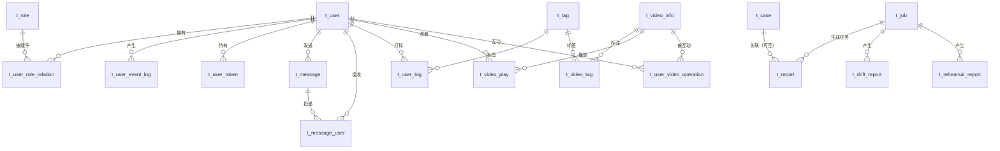

# 数据库设计

> 本文是毕业论文「数据库设计」章节的素材。库名 `short_video_heat_db`，字符集 `utf8mb4`，存储引擎 InnoDB。
> 物理结构以 Flyway 迁移文件 `backend/src/main/resources/db/migration/V1~V7`（共 7 个）为准。Docker 首次启动时先执行根目录 `sql/short_video_heat_db.sql` 建库建表并写入种子数据，随后后端启动由 Flyway 以 V1 为基线（`baseline-on-migrate: true`）补跑 V2~V7 增量。

## 1. 设计说明

- **两类数据分离**：账号/内容等基础表（V1，13 张）与热度预测业务表（V2~V7，7 张）分离，基础表沿用通用视频平台模型，业务表围绕"预测—解释—实验—治理—交付"设计。
- **快照优先**：报告与预演会冗余保存 `model_version`、`data_version`、`case_name` 等快照字段，保证上游改名/删除后历史报告仍可解释。
- **逻辑关联而非强外键**：业务表之间（如 `t_report.case_id → t_case.id`、`t_heat_predict_log.creator_id → t_user.id`）只建索引不建外键，避免跨模块删除受限与迁移阻塞；V1 基础表保留原有外键约束。
- **可观测字段**：任务、审计、报告均含 `trace_id` / `cost_ms` / `create_time`，支持按链路追查。

## 2. ER 关系

> 注：`t_heat_predict_log`、`t_operation_log` 为独立流水表，只通过 `creator_id` / `user_id` 逻辑关联用户；`t_drift_report`、`t_rehearsal_report` 为治理报告流水。

## 3. 表清单与关键字段

### 3.1 基础表（V1，13 张）

| 表名 | 用途 | 关键字段 |
|---|---|---|
| `t_user` | 用户主表 | `id`、`user_uuid`、`user_name`、`password`（BCrypt，60 字符）、`real_name`、`status`（1 启用/2 禁用）、`role`、`deleted`、`create_time` |
| `t_role` | 角色定义 | `role_id`、`role_name`（如 `ADMIN`）、`role_describe` |
| `t_user_role_relation` | 用户-角色关联 | `user_id`、`role_id`，双外键 + 索引 |
| `t_user_event_log` | 用户事件日志（登录/登出等） | `user_id`、`user_name`、`content`、`create_time` |
| `t_user_token` | 登录令牌 | `token`、`user_id`、`create_time`、`end_time`、`user_name` |
| `t_message` | 站内消息 | `title`、`content`、`send_user_id`、`receive_user_count`、`read_count`、`create_time` |
| `t_message_user` | 消息投递与已读状态 | `message_id`、`receive_user_id`、`readed`、`read_time` |
| `t_tag` | 标签字典 | `tag_id`、`tag_name` |
| `t_user_tag` | 用户-标签 | `user_id`、`tag_id`、`user_property_flag` |
| `t_video_info` | 视频主表（含电影元数据扩展列） | `video_id`、`video_name`、`video_category`、`creator_id`、`original_title`、`budget`、`revenue`、`popularity`、`vote_average`、`release_date`、`heat_score` 等 |
| `t_video_tag` | 视频-标签 | `video_id`、`tag_id`、`video_property_flag` |
| `t_video_play` | 播放记录 | `video_id`、`user_id`、`play_times`、`last_play_time` |
| `t_user_video_operation` | 用户对视频的互动 | `id`（用户）、`video_id`、`thumb_up`、`collection`、`praise_bad_reviews`、`comment`、`finally_active_time`；联合主键 `(id, video_id)` |

### 3.2 预测与审计（V2、V3）

| 表名 | 用途 | 关键字段 |
|---|---|---|
| `t_heat_predict_log` | 每次预测的流水，支撑"预测记录"页 | `id`、`model`、`video_category`、`author_fans`、`publish_hour`、`publish_weekday`、`publish_month`、`prediction`、`prediction_log`、`grade`、`source`（single/batch）、`creator_id`、`create_time`；索引 `idx_create_time` |
| `t_operation_log` | 管理操作审计（`@OperationLog` 切面写入） | `user_id`、`user_name`、`operation`（如 `model.promote`）、`method`（Controller#方法）、请求参数摘要、结果摘要、`error_msg`、`cost_ms`、`ip`、`create_time` |

### 3.3 任务中心（V4）

| 表名 | 用途 | 关键字段 |
|---|---|---|
| `t_job` | 长耗时任务状态机 | `id`、`job_type`（如 `data.import`）、`status`（QUEUED/RUNNING/DONE/FAILED）、`params`（JSON）、`result`（JSON 摘要）、`error_msg`、`trace_id`、`user_id`、`cost_ms`、`create_time`、`start_time`、`finish_time`；索引 `idx_job_status`、`idx_job_type`、`idx_job_create_time` |

### 3.4 场景库（V5）

| 表名 | 用途 | 关键字段 |
|---|---|---|
| `t_case` | 一次分析先验输入的可复用场景 | `id`、`name`、`description`、`model`、`video_category`、`author_fans`、`publish_hour`、`publish_weekday`、`publish_month`、`source`（manual/data-sample）、`user_id`、`create_time`、`update_time`；索引 `idx_case_user`、`idx_case_create_time` |

### 3.5 模型治理（V6）

| 表名 | 用途 | 关键字段 |
|---|---|---|
| `t_drift_report` | 跨平台特征漂移报告 | `reference_platform`、`max_psi`（≥0.25 显著漂移）、`stable_ratio`、`worst_platform`、`worst_feature`、`detail_json`（逐平台×特征 PSI/KS）、`job_id`、`create_time` |
| `t_rehearsal_report` | 上线预演报告 | `model`、`candidate_version`、`active_version`、`sample_size`、`mean_abs_diff_pct`、`p50_abs_diff_pct`、`p90_abs_diff_pct`、`max_abs_diff_pct`、`pearson_corr`、`top10_overlap`、`passed`、`detail_json`、`job_id`、`create_time`；索引 `idx_rehearsal_model_version` |

### 3.6 报告中心（V7）

| 表名 | 用途 | 关键字段 |
|---|---|---|
| `t_report` | 自包含 HTML 归因报告 | `name`、`report_type`、`case_id`、`case_name`（快照）、`model`、`model_version`、`data_version`、`feature_version`、`params`（JSON）、`status`（GENERATING/DONE/FAILED）、`file_name`、`file_path`、`size_kb`、`prediction`、`grade`、`error_msg`、`share_token`、`job_id`、`user_id`、`create_time`、`finish_time`；唯一键 `uk_report_share_token`，索引 `idx_report_user`、`idx_report_case`、`idx_report_create_time` |

## 4. 索引与约束设计

| 类别 | 设计 |
|---|---|
| 主键 | 基础表 `int` 自增；业务流水表 `bigint` 自增，避免长期增长溢出 |
| 查询索引 | 列表页按"时间倒序"为主：`idx_create_time`（预测、审计、报告）、`idx_job_create_time`；状态筛选：`idx_job_status`、`idx_job_type` |
| 归属索引 | `idx_report_user`、`idx_case_user`、`idx_report_case`，支撑"我的报告/场景报告"过滤 |
| 唯一约束 | `uk_report_share_token`：分享令牌唯一，保证免登录链接不可枚举 |
| 外键 | 仅 V1 基础表保留（用户-角色、消息投递、视频-标签等），业务表不建外键 |
| 冗余快照 | `t_report.case_name`、`model_version`、`data_version`、`feature_version`；`t_rehearsal_report.active_version` |

## 5. Flyway 版本对应

| 版本 | 文件 | 内容 |
|---|---|---|
| V1 | `V1__init_schema.sql` | 基础 13 表 + 种子数据 + `t_video_info` 电影元数据扩展列 |
| V2 | `V2__heat_predict_log.sql` | 预测流水表 |
| V3 | `V3__operation_log.sql` | 操作审计表 |
| V4 | `V4__job.sql` | 任务中心表 |
| V5 | `V5__case.sql` | 场景库表 |
| V6 | `V6__governance.sql` | 漂移报告 + 预演报告 |
| V7 | `V7__report.sql` | 报告中心表 |

## 6. 与文件系统的对应

| 数据 | 位置 | 说明 |
|---|---|---|
| 原始数据 | `data/raw/` | 上传落盘，导入前不改动 |
| 规范化数据集 | `data/processed/<platform>_clean.csv` | 列名统一后的训练/展示数据 |
| 数据集注册表 | `data/processed/dataset_registry.json` | 样本量、类别数、时间跨度 |
| 数据集版本 | `data/processed/dataset_versions.json` | 数据版本与校验信息，报告引用 |
| 质量门禁 | `data/processed/quality_report.json` | 8 项断言结果 |
| 模型注册表 | `data/models/model_registry.json` | 版本、阶段、指标、体积 |
| 归因报告 | `data/reports/*.html` | 自包含 HTML，`t_report.file_path` 指向 |

> 文件与数据库的分工：**大对象入文件、元数据入表**。报告 HTML、模型文件不入库，避免大字段拖慢备份与查询。
