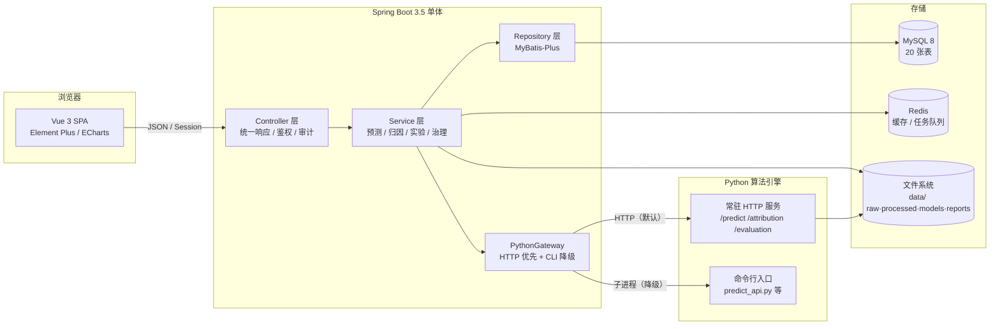
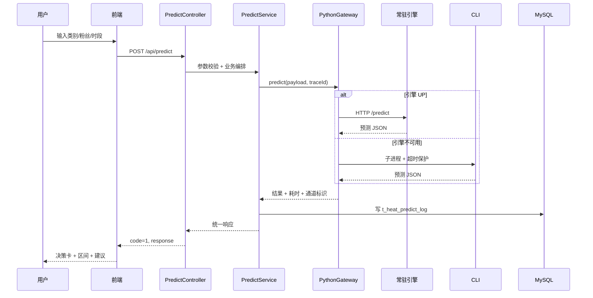
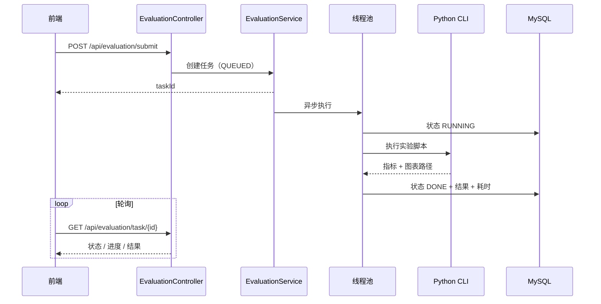
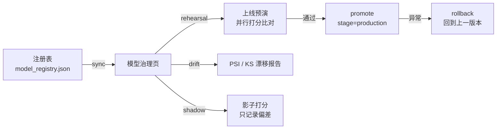

# 概要设计

> 本文是毕业论文「系统设计」章节的素材，描述总体架构、模块划分、关键链路与设计取舍。
> 需求见 [需求与用例.md](./需求与用例.md)，表结构见 [数据库设计.md](./数据库设计.md)。

## 1. 设计目标

| 目标 | 设计手段 |
|---|---|
| 预测可用 | 只用发布时先验特征；常驻推理服务 + CLI 双通道 |
| 结论可信 | SHAP 归因 + 保形区间 + 解释质量指标（紧凑性/一致性/稳定性） |
| 过程可复现 | 实验异步任务 + 实验台账（参数/耗时/traceId/结果） |
| 模型可运营 | 模型注册表 + 阶段 + 影子打分 + 上线预演 + 回滚 |
| 工程可交付 | 统一响应、Flyway、Docker Compose、审计、任务中心、健康检查 |

## 2. 总体架构

**架构风格**：前后端分离 + 模块化单体（modular monolith）。选择单体而非微服务：答辩场景下部署成本低、事务与鉴权简单，且模块边界（预测/归因/实验/治理/场景/报告/任务）已足够清晰。

## 3. 分层与模块职责

### 3.1 后端分包（`com.alvis.media`）

| 包 | 职责 |
|---|---|
| `controller` | 路由与参数校验；继承 `BaseApiController`，统一返回 `RestResponse` |
| `service` / `service.impl` | 业务编排；事务边界；调用 PythonGateway |
| `repository` | MyBatis-Plus Mapper |
| `domain` | 数据库实体 |
| `viewmodel` | 请求/响应模型（含 `scenario` 等子包） |
| `utility` | `PythonGateway`（HTTP/CLI 双通道）、`PythonCliRunner`（超时强杀、traceId 透传） |
| `aspect` / `annotation` | `@OperationLog` 审计切面 |
| `config` / `configuration` | 安全、CORS、Swagger、异步线程池、限流 |
| `context` | 当前登录用户上下文 |
| `exception` | `BusinessException(code)` 与全局异常处理 |
| `event` / `listener` | 登录事件等松耦合通知 |

### 3.2 前端分包（`frontend/src`）

| 目录 | 职责 |
|---|---|
| `views` | 页面：dashboard / data / analysis / predict / attribution / evaluation / model / case / report / grading / screen / about / system / user |
| `components` | 通用组件：`AppSkeleton`、`AppEmpty`、`InsightCard`、`ConfidenceBadge`、`JobProgress`、`CommandPalette`、`DemoTour` |
| `api` | 按域封装的请求（data / predict / evaluation / model / case / report / user …） |
| `utils` | `request`（统一响应拦截）、`chart` + `echartsTheme`（统一主题）、`projectStats`（本地统计缓存） |
| `layout` | 侧边栏、导航、标签页、场景对比托盘 |
| `store` | Vuex（用户、权限、场景、对比托盘，均 namespaced） |

### 3.3 算法目录（`algorithm`）

| 目录 | 职责 |
|---|---|
| `datasets` | 多平台 AST 归一化、数据接入、质量检查、版本登记 |
| `FeatureEDA` | 静态 EDA 图生成 |
| `prediction` | 六模型训练/推理、保形区间、what-if、常驻服务 |
| `attribution` | 全局/局部 SHAP、PDP、解释报告 |
| `evaluation` | 交叉验证、消融、鲁棒性等 17 类实验 |
| `grading` | K-Means 分级阈值与分类器对照 |
| `service` | 常驻 HTTP 推理服务 |
| `tests` | 35 个测试函数（47 条用例） |

## 4. 关键链路

### 4.1 单条预测（双通道）

要点：请求头透传 `X-Trace-Id`；HTTP 失败自动降级 CLI；CLI 超时由 `PythonCliRunner` 强制结束并转为可读业务异常。

### 4.2 异步实验

要点：分钟级实验不占用长连接；前端展示进度条与已耗时；失败保留错误信息并可重试（对应任务中心）。

### 4.3 归因与报告

1. 全局解释：Python 产出 SHAP 重要性 JSON + beeswarm 图；
2. 单样本解释：Top-K 贡献、基线值、预测值构成瀑布数据；
3. 解释质量：紧凑性（Top-K 覆盖贡献比例）、一致性（扰动后排名稳定）、稳定性（重复采样方差）；
4. 报告：后端把结论、图表（Base64 内嵌）、参数快照渲染为自包含 HTML，落库 `t_report` 并写文件；
5. 分享：生成令牌，`/api/report/shared/{token}` 免登录只读访问。

### 4.4 模型治理闭环

## 5. 契约与横切设计

| 设计点 | 方案 |
|---|---|
| 统一响应 | `RestResponse{code,message,response}`；前端仅 `code===1` 视为成功并返回整个 body |
| 错误码 | `BusinessException(code)` + 全局处理器；参数错误 400，未登录 401，无权限 403，资源不存在 404 |
| 链路追踪 | 过滤器生成/透传 `X-Trace-Id`，日志与任务台账均可检索 |
| 审计 | `@OperationLog` 切面记录操作人、方法、参数摘要、结果、耗时、IP |
| 异步 | 专用线程池；任务状态机 `QUEUED → RUNNING → DONE / FAILED` |
| 缓存 | Redis 用于会话/热点；进程内缓存在数据导入后主动失效 |
| 数据库变更 | Flyway `V1~V7`，随应用启动自动迁移 |
| 前端图表 | 统一注册 `app` 主题（调色板、轴、tooltip、grid），避免各页面风格漂移 |
| 降级 | 引擎不可用降级 CLI；接口不可用回退本地缓存/默认值；空态与错误态组件化 |

## 6. 技术选型与理由

| 层次 | 选型 | 理由 |
|---|---|---|
| 前端 | Vue 3 + Element Plus + ECharts | 学习成本低、组件齐全；ECharts 满足大屏与交互图 |
| 状态 | Vuex（namespaced） | 与项目既有模板一致，场景与对比托盘需跨页共享 |
| 后端 | Spring Boot 3.5 + Java 17 | 生态成熟，Session 鉴权简单可控，便于答辩讲解 |
| 持久层 | MyBatis-Plus | SQL 可读、分页简单、便于论文展示表结构 |
| 数据库 | MySQL 8 | 通用、易部署；Flyway 保证可复现 |
| 缓存/队列 | Redis | 会话与任务状态；容器化简单 |
| 算法 | Python + LightGBM/XGBoost/CatBoost + SHAP | 表格数据强基线；SHAP 提供可解释性 |
| 引擎交互 | HTTP 常驻 + CLI 降级 | 兼顾延迟与可用性，CLI 也便于实验复现 |
| 部署 | Docker Compose | 一键拉起四服务，healthcheck 保证启动顺序 |

## 7. 设计取舍

1. **不把播放/互动特征放进模型**：虽然能提高 R²，但发布时不可得，属于泄漏；论文明确以「发布前先验」为边界。
2. **不上微服务**：治理、实验、报告共享大量数据与鉴权逻辑，拆分会放大部署与事务成本。
3. **算法产物以 JSON 为契约**：Java 不重写算法，只做编排与展示；算法可独立测试（47 条）与替换。
4. **页面数字全部可溯源**：关于页、登录页展示的统计来自接口或缓存，避免"写死的漂亮数字"。
5. **交互与静态双轨 EDA**：交互图用于探索，静态图用于论文插图与答辩讲证据，两者并存。
