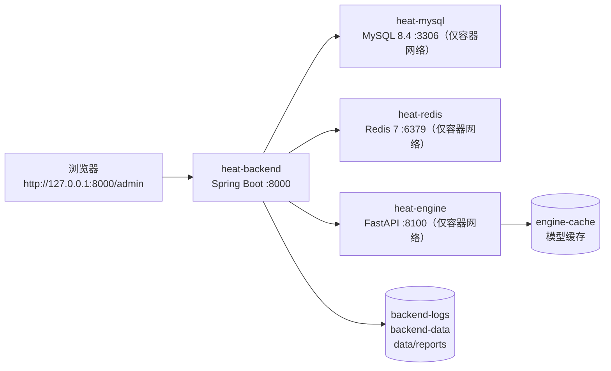

# 部署手册

> 面向答辩演示与"换一台机器复现"两种场景，覆盖 Docker 一键部署与本地开发部署。
> 拓扑参数取自 `deploy/docker-compose.yml`、`deploy/.env.example`；数据库版本策略取自 `backend/src/main/resources/application.yml`。

## 1. 部署架构



| 服务 | 镜像 | 端口 | 暴露到宿主机 | 说明 |
|---|---|---|---|---|
| `mysql` | `mysql:8.4` | 3306 | 否 | 首次启动执行 `sql/` 初始化脚本；字符集 utf8mb4 |
| `redis` | `redis:7-alpine` | 6379 | 否 | AOF 持久化（`--appendonly yes`） |
| `engine` | 本地构建 `heat-engine:latest` | 8100 | 否 | 常驻推理服务，镜像内置 HEALTHCHECK |
| `backend` | 本地构建 `heat-backend:latest` | 8000 | 是（`BACKEND_PORT`） | 仅后端对外，前端静态资源随包发布 |

> 安全默认：数据库与 Redis **不映射宿主机端口**，只允许后端容器访问；对外仅暴露后端一个端口。

## 2. 方式一：Docker 一键部署（推荐）

### 2.1 前置

- Docker Desktop（含 Docker Compose v2）
- 可用内存 ≥ 4 GB（MySQL + Redis + 引擎 + 后端）

### 2.2 步骤

```batch
:: 1. 准备环境变量
copy deploy\.env.example deploy\.env

:: 2. 构建并启动（首次会构建后端与算法引擎镜像）
docker compose -f deploy\docker-compose.yml --env-file deploy\.env up -d

:: 3. 查看状态（四个服务均应为 running / healthy）
docker compose -f deploy\docker-compose.yml ps
```

### 2.3 启动顺序

由 `depends_on.condition: service_healthy` 保证：

```text
mysql(healthy) + redis(healthy) + engine(healthy) → backend 启动
```

- MySQL：`mysqladmin ping` 连续通过，`start_period` 40 s；
- Redis：`redis-cli ping`；
- 引擎：镜像 HEALTHCHECK 探测 8100 健康端点。

### 2.4 首次初始化

- MySQL 容器首次启动执行 `sql/short_video_heat_db.sql`（建库建表 + 种子数据）与 `sql/migration_heat_predict_log.sql`；
- 后端启动时 Flyway 接管增量：配置 `baseline-on-migrate: true`、`baseline-version: 1`，对已存在的库以 V1 为基线，只补跑 `V2~V7`；
- 默认管理员：`admin / 123456`（BCrypt 入库）。

### 2.5 验证

```powershell
# 后端存活
curl http://127.0.0.1:8000/admin/index.html

# 未登录访问业务接口应返回 401（默认拒绝）
curl http://127.0.0.1:8000/api/data/platforms

# 容器日志
docker logs -f heat-backend
docker logs -f heat-engine
```

### 2.6 停止与清理

```batch
:: 停止（保留数据卷）
docker compose -f deploy\docker-compose.yml down

:: 停止并删除数据卷（慎用：会清空数据库与模型缓存）
docker compose -f deploy\docker-compose.yml down -v
```

## 3. 方式二：本地开发部署（Windows）

### 3.1 前置

| 依赖 | 版本 | 检查命令 |
|---|---|---|
| JDK | 17（必须） | `java -version` |
| Maven | 3.8+ | `mvn -v` |
| Node.js | 20+ | `node -v` |
| Python | 3.10+ | `python --version` |
| MySQL | 8.0 | 服务已启动，端口 3306 |
| Redis | 5+ | 服务已启动，端口 6379 |

### 3.2 初始化

```batch
:: 1. Python 虚拟环境 + 依赖
setup_venv.cmd

:: 2. 数据库（一次即可）
mysql -u root -p < sql/short_video_heat_db.sql

:: 3. 启动常驻推理引擎（新窗口，保持运行）
run_engine_service.cmd

:: 4. 启动后端 + 前端（脚本内完成构建与静态资源拷贝）
restart_backend.cmd
```

访问 `http://localhost:8000/admin`，默认账号 `admin / 123456`。

### 3.3 分步启动（便于调试）

```powershell
# 后端
cd backend
mvn -q -Dmaven.test.skip=true spring-boot:run

# 前端（开发模式，热更新）
cd frontend
npm install --registry=https://registry.npmmirror.com
npm run dev

# 前端（生产构建）
npm run build
robocopy frontend\admin backend\target\classes\static\admin /MIR
```

### 3.4 算法首次调用

模型缓存缺失时首次预测会自动训练；也可提前预热：

```powershell
.venv\Scripts\python.exe algorithm\prediction\predict_api.py --mode train
.venv\Scripts\python.exe algorithm\attribution\shap_analysis.py --mode global
.venv\Scripts\python.exe algorithm\evaluation\model_evaluation.py --mode cv --folds 5
```

## 4. 环境变量

### 4.1 Docker（`deploy/.env`）

| 变量 | 默认值 | 说明 |
|---|---|---|
| `BACKEND_PORT` | `8000` | 后端对外端口，容器内固定 8000 |
| `DB_NAME` | `short_video_heat_db` | 数据库名 |
| `DB_USERNAME` | `root` | 数据库账号 |
| `DB_PASSWORD` | `123456` | 数据库口令（示例值，生产必须修改） |

### 4.2 后端（compose 注入 / `application.yml`）

| 变量 | 说明 |
|---|---|
| `SPRING_PROFILES_ACTIVE` | `prod`（容器）/ `dev`（本地） |
| `DB_URL` | JDBC URL，容器内主机名为 `mysql` |
| `REDIS_HOST` | 容器内为 `redis` |
| `ENGINE_SERVICE_URL` | 常驻引擎地址，容器内 `http://engine:8100`；本地为 `http://127.0.0.1:8100` |
| `LOG_PATH` | 日志目录，容器内 `/app/backend/log/` |

### 4.3 关键机制

- 引擎地址必须使用**容器名**而非 `127.0.0.1`，否则后端无法访问引擎；
- 引擎 30 秒熔断：不可用时自动降级 CLI，结果一致但延迟上升；
- 修改数据库用户后需清理 Redis `User::*` 缓存，否则登录读到旧值（重置脚本会自动清理）。

## 5. 健康检查与验收清单

| 检查项 | 预期 |
|---|---|
| `docker compose ps` | 四服务 running，mysql/redis/engine 为 healthy |
| 后台首页 | 200，可打开登录页 |
| 登录 `admin/123456` | 成功进入工作台 |
| `GET /api/data/platforms`（登录后） | `code=1`，返回平台列表 |
| `GET /api/predict/engine` | 状态为 `UP`（引擎已启动） |
| 预测页提交一次 | 返回热度、等级、模型版本 |
| 实验中心提交一个实验 | 状态 QUEUED→RUNNING→DONE |
| 大屏 `/screen/index` | 全屏四幕正常轮播 |

## 6. 日志、数据与备份

| 内容 | 位置（容器） | 位置（本地） |
|---|---|---|
| 后端日志 | `backend-logs` 卷 `/app/backend/log/` | `backend/log/` |
| 引擎日志 | `engine-logs` 卷 `/app/data/logs` | `data/logs/` |
| 模型缓存 | `engine-cache` 卷 | `algorithm/prediction/model_cache/` |
| 原始/规范化数据 | `backend-data` 卷 `/app/data` | `data/raw`、`data/processed` |
| 报告文件 | `backend-data` 卷 | `data/reports/` |
| 数据库 | `mysql-data` 卷 | MySQL 数据目录 |

备份建议：`mysqldump` 导出业务表 + 打包 `data/`（含报告与注册表）+ 备份模型缓存。

## 7. 常见问题

| 现象 | 原因 | 处理 |
|---|---|---|
| 后端启动报 Flyway 校验失败 | 手动改过表结构，与迁移文件不一致 | 恢复结构或 `flyway repair` 后重启；不要直接改 `flyway_schema_history` |
| 登录提示用户名或密码错误但密码正确 | Redis 中 `User::*` 为旧值 | 执行 `python tools/ops/reset_user_password.py --user admin --password 123456`（自动清缓存） |
| 预测很慢（约 1 s） | 常驻引擎未启动，降级到 CLI | 启动 `run_engine_service.cmd` 或检查 `engine` 容器；访问 `/api/predict/engine` 确认状态 |
| 页面图表空白 | `frontend/public/eda` 下 PNG 缺失或静态资源未拷贝 | 重新 `npm run build` 并 `robocopy` 到 `backend/target/classes/static/admin` |
| 上传大文件失败 | 请求体/超时限制 | 上传接口超时已放宽至 30 分钟；反向代理需同步调大 `client_max_body_size` |
| 端口被占用 | 8000/3306/6379 已有进程 | 改 `BACKEND_PORT` 或释放端口；`netstat -ano | findstr :8000` |
| 引擎状态 DEGRADED | 引擎进程在但模型加载失败 | 查看 `data/logs`，先执行一次 `--mode train` 预热 |

## 8. 安全配置清单

| 项 | 当前配置 | 上线前建议 |
|---|---|---|
| 数据库口令 | 示例 `123456` | 改为强口令并通过 `.env` 注入，不入库 |
| 管理账号 | `admin/123456` | 首次登录立即修改 |
| 数据库/Redis 端口 | 未映射宿主机 | 保持不暴露 |
| 默认拒绝 | 除登录外全部需认证 | 保持 |
| 分享链接 | 令牌唯一、免登录只读 | 定期清理过期令牌 |
| 日志 | 含 traceId，不记录明文口令 | 保持脱敏 |
| HTTPS | 本机演示未启用 | 生产环境由反向代理终止 TLS |
